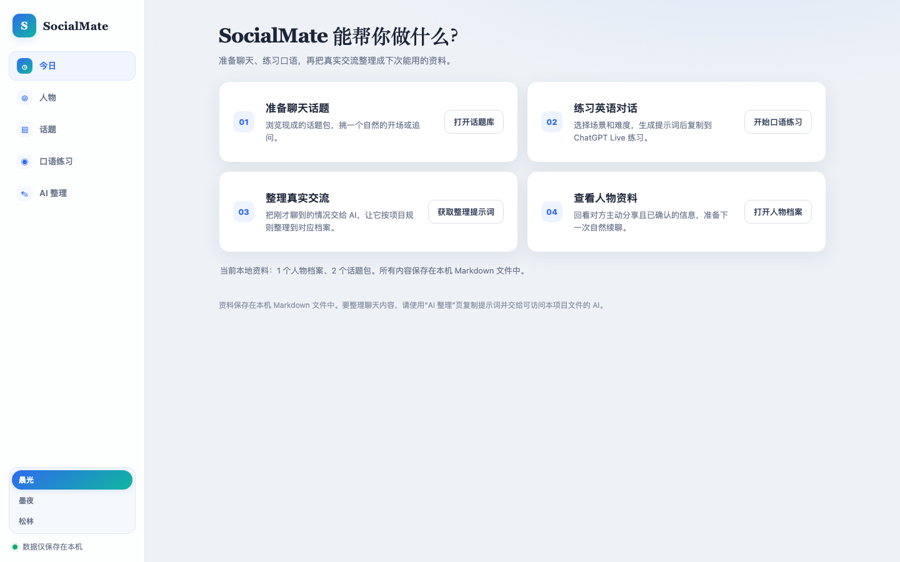
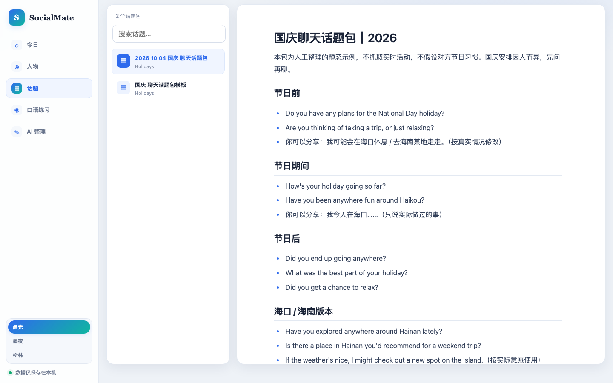
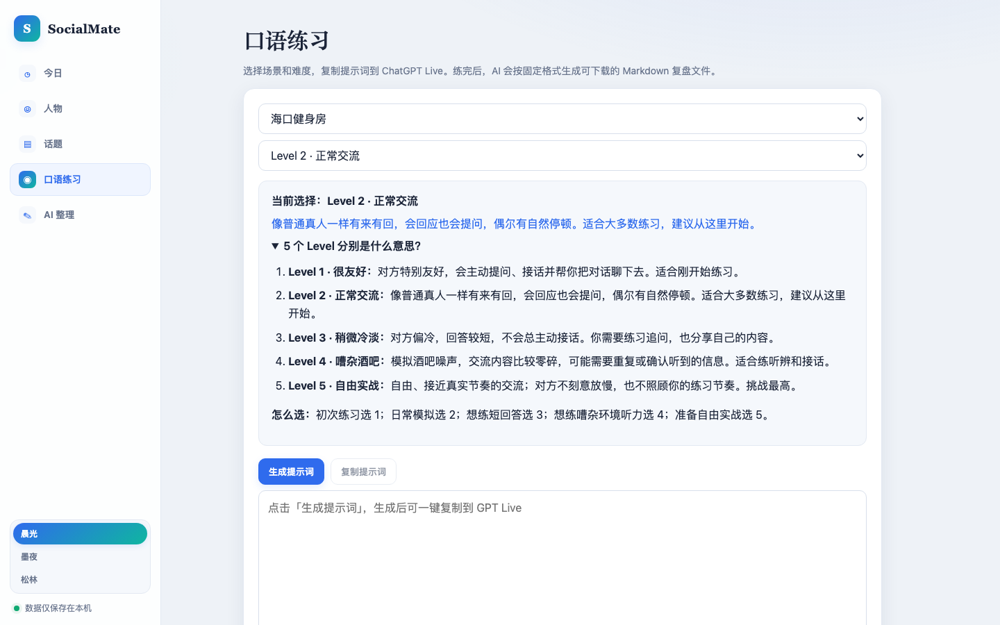

# SocialMate (Foreign-Language Social System · ALW-001)

[简体中文](./README.md)

A local-first social knowledge-base MVP: prepare conversation topics, practice
speaking by scenario and difficulty, and turn real conversations into people
profiles — all stored as plain Markdown files you own. The local server listens
only on `127.0.0.1` (your own machine). There are no external dependencies, no
accounts, no cloud sync, and no AI API calls.

<p align="center">
  
  
</p>
<p align="center">
  
</p>

## What it does

- **Topic library**: browse local Markdown topic packs with a searchable list on
  the left and the content opened on the right; the last topic you read is remembered.
- **Speaking practice**: pick a scenario and one of 5 difficulty levels (from
  "very friendly" to "free real-world pace"), then generate and copy a practice
  prompt with one click and paste it into ChatGPT Live.
- **AI organize**: copy the organize prompt and send it, together with what you
  just talked about, to an AI that can access this project's files; it files the
  conversation into the matching person profile following the project's rules.
- **People profiles**: create new profiles locally, search by name, and expand
  and read the Markdown profile in place.
- **Three themes**: Dawn (light), Ink Night (dark), Pine Forest (warm green
  paper feel), switched directly from a segmented control, with the preference
  persisted.
- **Wiki-style layout**: functions live in a left sidebar and open in the right
  content area — switching sections never reloads a page.

## Quick start: run it locally

Requires Node.js 20+. The first run creates `SocialMate-Data` inside this project and
writes fictional demo people and templates; existing files are never overwritten.

```sh
node scripts/initialize-data.mjs
node server.mjs
```

Open [http://127.0.0.1:4173](http://127.0.0.1:4173) on this machine. To stop, press
`Ctrl+C` in the server terminal. If port 4173 is taken, pick a free one:

```sh
PORT=4174 node server.mjs
```

Data directory: `SocialMate-Data/` (inside the project root); override it with the
`SOCIALMATE_DATA_DIR` environment variable. The server binds only to the loopback
address — LAN access from a phone is not supported.

## Docker deployment

The project is identified as `alw-001-foreign-language-social-system`. The production
deployment copy lives in `~/Developer/coding/docker/alw-001-foreign-language-social-system/`;
the real Markdown data is mounted from `~/DockerData/alw-001-foreign-language-social-system/`,
and pre-deployment snapshots are kept in `~/DockerBackups/alw-001-foreign-language-social-system/`.
Compose publishes the service only to `127.0.0.1:4173` — it is never exposed to the LAN.
The container uses `restart: unless-stopped`; its lifecycle is managed by Docker.

For a first deployment, create `.env.local` in the deployment copy (copy from
`.env.example` and fill in real absolute paths), make sure `APP_DATA_DIR` exists and
contains the initialized Markdown data, then run:

```sh
docker compose --env-file .env.local up -d --build
docker compose --env-file .env.local ps
```

Health check: `http://127.0.0.1:4173/api/health`. Logs: `docker compose --env-file .env.local logs --tail=100`.
Stop: `docker compose --env-file .env.local stop`. Containers are removed only with
explicit user authorization; DockerData and DockerBackups must never be deleted.

## Data and review

Markdown files are the single source of truth. Edits to a person's main profile must go
through the Review flow's preview and confirmation; if a candidate edit has become
outdated after its preview, it is rejected. Interaction records cannot be overwritten
through the review API. The demo person `Test-Anna` is entirely fictional; delete
`SocialMate-Data/People/Test-Anna` to remove her.

## Environment and verification

- Uses Node's built-in HTTP and file modules; no packages to install and no API keys.
- `node scripts/initialize-data.mjs` initializes the directory tree and templates.
- `node --test` runs the local-server acceptance tests.
- GitHub: `wanghoufan/alw-001-foreign-language-social-system` (private)

## Speaking-practice records

After each ChatGPT Live practice session, a downloadable complete Markdown (`.md`)
review file should be produced. The file name format is
`口语练习 YYYY-MM-DD - 场景短名 - Level N - 8位标识.md` (the prefix 口语练习 means
"speaking practice"); dates follow Asia/Shanghai; vertical bars and the formal
archive naming rules are not used here. After downloading, put the raw single-session
record into `SocialMate-Data/Practice/Sessions/`. Weekly and monthly analyses go into
`SocialMate-Data/Practice/Reviews/Weekly/` and `Monthly/` respectively, and each report
must cite the file names of the single-session records it is based on; raw records must
never be rewritten. Every single-session record keeps, as far as available: the dialogue
transcript, a practice overview, comprehension and responses, original sentences with
natural rewrites, interaction rhythm, reusable expressions, at most 3 actionable goals
for next time, and open questions. Transcripts must never be back-filled by invention,
and pronunciation must not be inferred from text alone.
