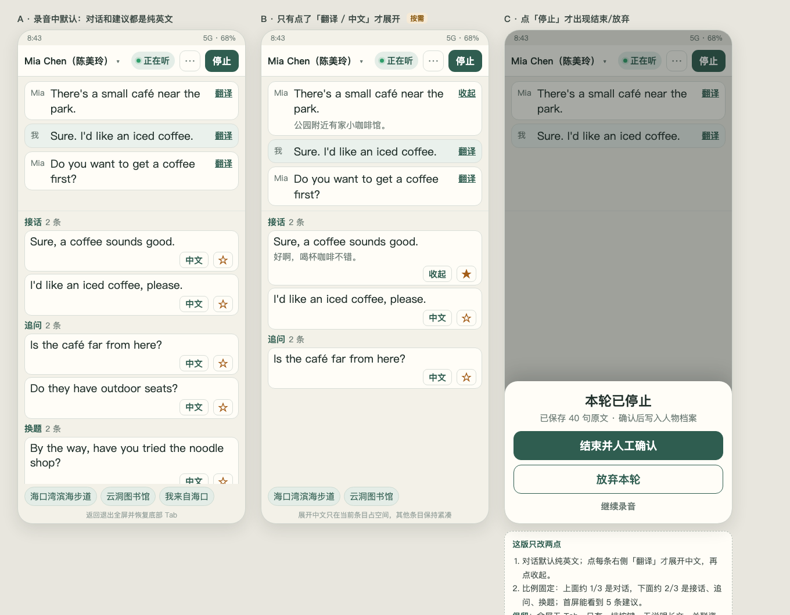
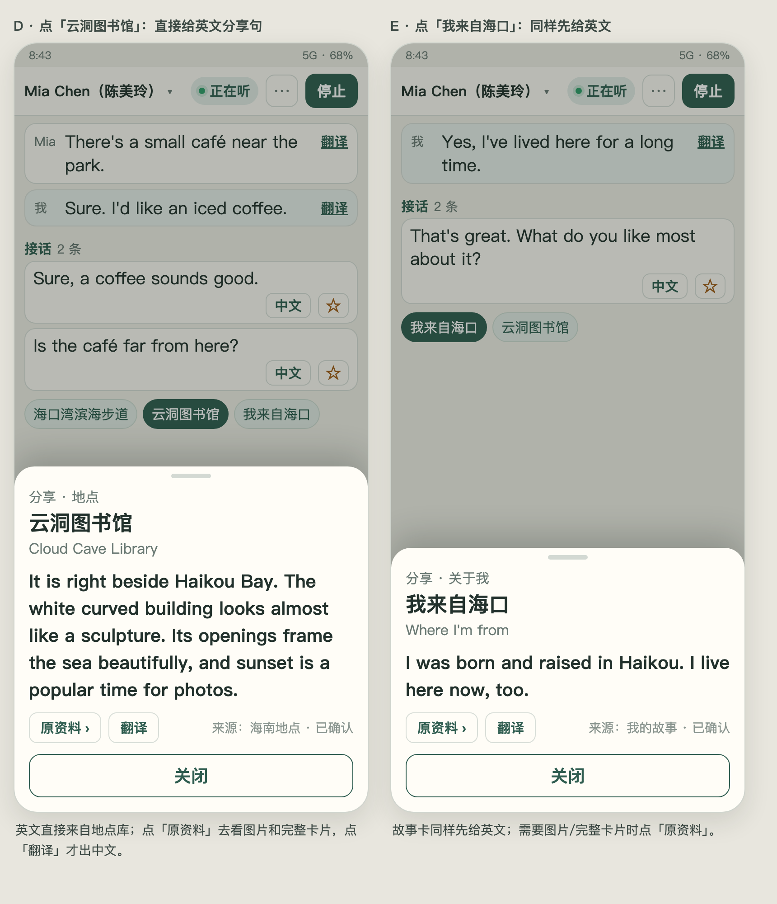
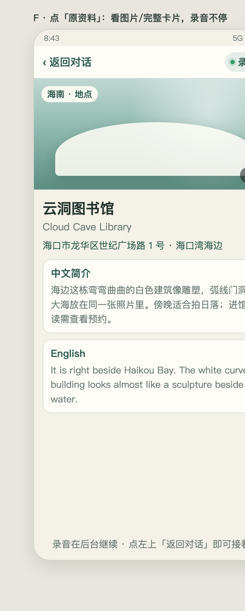

# PLAN｜布局规格与实现方案

## 1. 尺寸与比例（393×852 基准）



| 区域 | 高度 | 说明 |
|---|---|---|
| 状态栏 | 26 | 系统 |
| 顶部控制 | 54 | 唯一一排按键 |
| 对话区 | 232（≈1/3） | 最近 3 句，纯英文，可内部滚动 |
| 建议区 | flex（≈552，≈2/3） | 接话 2 + 追问 2 + 换题 1/2，内部滚动 |
| 关联 chips | 40 | 一行横向，无标题 |
| 底部安全 | 6 | 无 Tab |

- 对话区固定 `flex:0 0 232px`；建议区 `flex:1; overflow-y:auto`。
- 首屏必须看到：3 句对话 + 5 条建议 + 3 个资料 chip。
- 字号：英文正文 19px、中文 15px、分区标题 15px、页面标题 23px；触控热区 ≥44px（收藏视觉 34，热区补足）。

## 2. 顶部控制（一排）

```
[Mia Chen（陈美玲）▾]  [● 正在听]  [⋯]  [停止]
```

- 对象：下拉选择，关联人物；未选时显示「选择对话对象」。
- 状态：正在听 / 重连中 / 已结束；连接方式并入 ⋯ 菜单。
- ⋯ 菜单：对调说话人、连接方式、诊断、退出全屏。
- 停止：调原生 `stopRecording()`。
- 删除「家庭 WiFi」常驻胶囊与「对调说话人」独立按钮。

## 3. 对话区

- 只显示最近 3 句（最新在上，沿用 V1.5 置顶）。
- 每句：说话人 + 英文 + 右侧「翻译」。
- 中文默认隐藏；点「翻译」→ 显示该句中文，按钮变「收起」；再点收起。
- 新增 `S.translated`（Set，键为 message id/eventId），只影响当前条，不全局翻译。
- 不显示「最近 3 句」标题、不显示「对话原文」。

## 4. 建议区

- 分区：`接话`、`追问`、`换题`（标题 15px，右侧条数 14px）。
- 数据：沿用 `suggestionsNow()` 的四方向结果，展示顺序改为 respond→ask→switch；分享方向保留数据但默认不占首屏（滚动到才见）。
- 首屏配额：respond 2、ask 2、switch 1；其余滚动可见。
- 卡片：英文 1–2 行；底部一行「中文 / 收起」+「☆/★」；无朗读、无复制。
- 中文展开只影响当前卡（`S.zhOpen` Set）。
- 保留阅读冻结：点/滚建议区后不自动重建，显示「有新的接话建议」徽标。
- AI 首候选保持：`S.aiState==='ready'` 时 AI 句子排最前，模板补足。

## 5. 关联资料



- 一行 chips（地点/关于我/人物/软件按当前匹配），无标题、无「来自数据库」、无类别标签。
- 点 chip → 分享卡抽屉（底部，高约 380，可遮住建议区下半）：
  - 小字类别（分享 · 地点/关于我/人物/软件）；
  - 中文标题 + 英文名；
  - **英文分享句**：地点取 `en` + `special_en`，故事取 `en`；默认显示英文，不截断（区域可滚动）；
  - 「翻译」按钮：展开对应中文（地点 `cn`、故事 `cn`）；
  - 「原资料 ›」按钮；
  - 来源小字（已确认资料 / 我的故事 / 人物档案）；
  - 「关闭」。
- 人物资料若无英文：显示中文事实 + 明确提示「该资料暂无英文表达」；不生成假英文。
- 抽屉打开时录音、字幕、建议继续更新。

## 6. 原资料页（新页面内视图）



- 由 `S.view='origin'` 控制，同一 WebView 内切换，不新建 Activity。
- 顶部：`‹ 返回对话` + 右侧「● 录音中」。
- 图片：地点 `photos[]` 横向滑动，角标 1/N；无图时显示占位。
- 内容：中英标题、地址、中文简介、English 简介；故事页显示故事全文中英。
- 返回：按钮或系统返回 → `S.view='chat'`，恢复全屏录音态；录音与 SSE 不受影响。
- 底部提示「录音在后台继续」。

## 7. 全屏与返回

- `S.immersive = true` 期间：隐藏 `.top`（页面标题栏）与 `.mobilebar`；不渲染 Tab。
- 进入条件：开始录音成功（`smNativeRecordingStarted`）。
- 退出条件：停止录音、或系统返回/「⋯→退出全屏」；退出后备份显示 `.top` 与 `.mobilebar`，录音继续。
- 原生 `AsrActivity` 拦截返回键：若页面沉浸，调用 JS `smExitImmersive()` 并消费事件；再次返回才退出 Activity（退出会停录，需确认）。

## 8. 停止与结束流程

- 移除常驻「结束并人工确认 / 放弃本轮」。
- 点「停止」→ 原生停录 → 页面弹底部 sheet：
  - **结束并人工确认**：进入现有复盘流程（`review()`），确认后写人物档案。
  - **放弃本轮**：关闭本轮，不写人物档案；已上传归档无法撤回，需在确认文案写明。
  - **继续录音**：关闭 sheet，回到全屏录音（重新开录）。
- 顺带修复：停止后归档等待从固定 1.5 秒改为「收到 ended 或最多 3 秒」，避免尾部 3 条只进页面不进归档。

## 9. 原生改动点（AsrActivity）

1. 返回键拦截（沉浸退出优先）。
2. `stopStreaming` 收尾：发送 end 后等待 ended/最多 3 秒再 `archive.end()`；超时照旧。
3. 新增 JS bridge：`exitImmersive` 由页面自行处理，无需原生；「继续录音」复用 `requestRecording()`。
4. 录制状态变化继续通过 `smNativeLinkState`/`smNativeRecordingStarted/Stopped` 通知页面。

## 10. 数据来源

- 地点：`socialmate-v1.2/source/places-115.json` 的 `en`、`special_en`、`en_name`、`cn`、`photos`。
- 故事：页面 `SAV.stories` 的 `en`、`cn`。
- 人物：`SAV.people` / 档案；仅中文时明确提示无英文。
- 软件：`D.apps` 的英文描述（若有）。

## 11. 风险与对策

| 风险 | 对策 |
|---|---|
| 全屏后找不到导航 | 返回/⋯→退出全屏；停止后自动恢复 Tab |
| 原生返回与 WebView 手势冲突 | 只拦 KEYCODE_BACK；页面内先退出沉浸 |
| 分享英文缺失（人物） | 明确提示，不编造；地点/故事有真实英文 |
| 尾部 final 丢失 | 改为等 ended/最多 3 秒 |
| 四方向数据回归 | 只改展示配额，不改 `suggestionsNow()` 生成逻辑 |
| 大改导致 V1.5 交互回退 | 保留冻结、置顶、AI 首候选；逐项验收 |

## 12. 版本与交付

- `versionCode 66`、`versionName 0.8.31`。
- 构建 `sh android-poc/build-apk.sh`；APK 复制到 `release/SocialMate-0.8.31-vc66-debug.apk`。
- 装机：Note 12T Pro 必装；Note 12 Pro 可选（同一 Wi-Fi）。
- 不提交、不推送、不部署，除非用户另行授权。