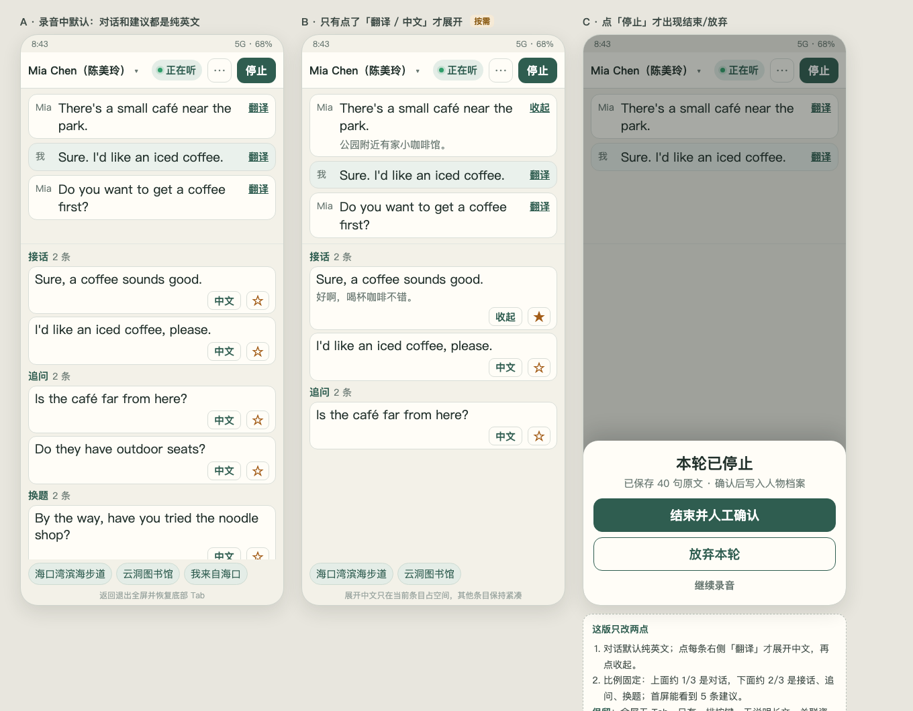
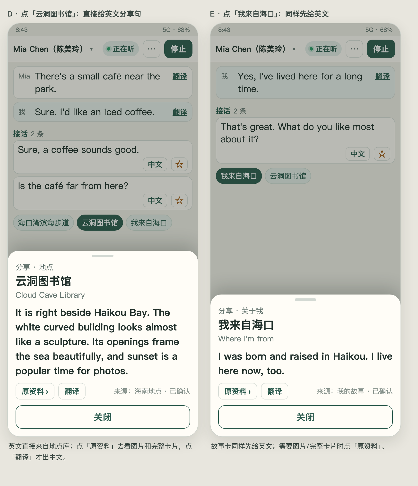
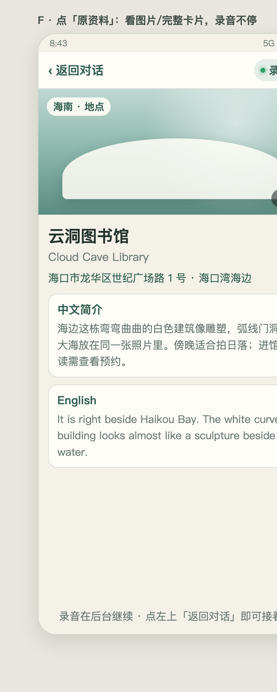

# ALW001 N05 V1.5.2 · 聊天录音页压缩与分享卡

> 状态：**真机 PASS（0.8.31/66，Note 11 5G 393×791）**；按需翻译、归档尾部、停止三动作均已实测（证据见 `qa/QA-REPORT.md`）
> 版本目标：Android **0.8.31 / versionCode 66**
> 排版源文件：`prototype.html`、`ref-detail.html`、`origin-detail.html`

## 0. 已确认的示意图（本计划以此为准）

**1. 整体布局**：A 录音默认（纯英文） / B 点翻译才展开 / C 停止弹层

**2. 关联资料分享卡**：默认英文分享句，可「翻译」或进「原资料」

**3. 原资料页**：看图片和完整卡片，返回对话，录音不停

## 1. 背景与目标

V1.5.1 已收口真实录音链路（握手鉴权、归档 201、断线重连）。真机试玩暴露的问题不是功能，而是**界面占满空间、现场不好用**：

- 顶部对象/状态/按钮 + 页面标题 + 底部 Tab 吃掉过多高度；
- 对话与建议默认都带中文，现场要自己找英文；
- 四方向 12 条竖排，必须反复滚动；
- 每条建议有朗读、复制、收藏三个按钮，卡片过高；
- 「结束并人工确认 / 放弃本轮」常驻底部，与「停止录音」重复；
- 关联资料点开只有中文摘要，不能直接照着说；想看图片还得离开对话。

本轮目标：**把录音页压成「上 1/3 对话 + 下 2/3 建议」，默认纯英文，点翻译才出中文；关联资料点开直接给英文分享句，并能跳原资料看图片，返回后录音不断。**

## 2. 已确认的交互（用户拍板）

1. 录音中全屏：隐藏页面顶栏与底部 5 个 Tab；系统返回退出全屏、恢复 Tab，录音继续。
2. 全屏只有**一排按键**：对象 · 状态 · ⋯ · 停止。
3. 删除所有说明文字：隐私长文、「英文为主 · 中文可展开」、「来自你已有的数据库」、模块标题。
4. 对话默认纯英文；每条右侧「翻译」，点了才展开中文，再点收起。
5. 建议：接话 / 追问 / 换题三类；首屏至少 5 条（接话 2、追问 2、换题 1），不横向翻。
6. 建议卡：删除朗读、复制；「中文」与「☆收藏」同一行；默认英文，中文按需。
7. 点「停止」后才弹出：结束并人工确认 / 放弃本轮 / 继续录音。
8. 关联资料：一行 chips，无标题、无类别标签；点开是**英文分享卡**（英文来自已确认资料），中文按「翻译」才出。
9. 分享卡新增「原资料 ›」：进入图片/完整卡片页；左上「返回对话」，顶部显示「录音中」。
10. 跳转原资料期间**录音不停止、会话不重建、字幕不断流**。

## 3. 不在本轮范围

- 不重做 ASR / 归档 / 握手鉴权（V1.5.1 已闭环）。
- 不新增云端 AI 付费调用；AI 首候选逻辑保持。
- 不改人物档案结构、不做自动翻译人物事实。
- 不做 360px 专项（本轮验收 393 档）；深色主题沿用现有变量。
- 不 commit / push / 发布，除非另行授权。

## 4. 验收口径

见 `ACCEPTANCE.md`。核心五条：

1. 393×852 真机：对话区约占 1/3、建议区约占 2/3，首屏可见 ≥5 条建议。
2. 默认无中文；点「翻译」只展开该条，再点收起。
3. 录音中无 Tab、无说明文字、只有一排按键；返回恢复 Tab 且录音不停。
4. 分享卡英文可直接朗读式照说；「原资料」进图片页再返回，录音与字幕连续。
5. 停止弹层三选项可用；本轮既有能力（四方向数据、AI 首候选、阅读冻结、归档 201）无回归。

## 5. 执行方式

按 `TASKS.md` 顺序执行；每完成一项在 `TASKS.md` 打勾并写证据。真机证据落 `qa/`。出现与计划冲突的现场约束，先改计划再改代码。